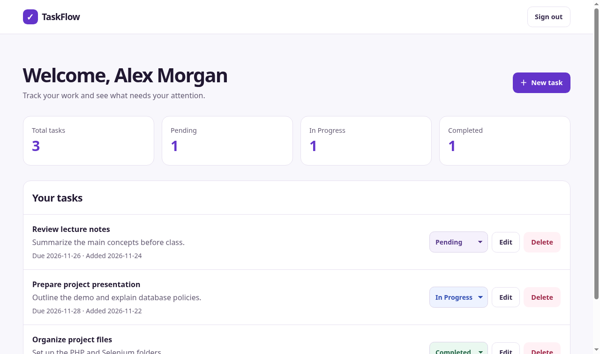

# TaskFlow

TaskFlow is a responsive web application for organizing daily tasks, setting due dates, and tracking progress. It was developed as a university project for **Web Development** and **Software Testing**, with a PHP application and a separate Java browser test suite.

## Features

- Register, sign in, and sign out with Supabase Auth.
- Create, edit, and delete tasks with an optional description and due date.
- Move tasks between **Pending**, **In Progress**, and **Completed**.
- See task totals and individual status counts on a dashboard that adapts to desktop and mobile screens.
- Access only the tasks associated with your account.

## Technology stack

| Layer | Technology |
| --- | --- |
| Frontend | HTML5, CSS3, JavaScript |
| Backend | PHP 8.1+ and cURL |
| Authentication and data | Supabase Auth, PostgreSQL, PostgREST |
| Testing | Manual test cases, Selenium WebDriver, Java 17+, JUnit 5, Maven |

## Architecture and security

PHP renders the pages, validates form submissions, and sends requests to Supabase. Authentication tokens are stored in the server-side PHP session. Forms use CSRF tokens, and user-provided content is escaped before rendering.

Each row in `public.tasks` has a UUID primary key and a `user_id` linked to `auth.users`. A task also stores its title, description, status, optional due date, and creation timestamp. PostgreSQL uses the authenticated user's ID to assign ownership. Row Level Security policies enforce ownership for reads, inserts, updates, and deletes.

## Run locally

### 1. Install the prerequisites

Use PHP 8.1 or later with the cURL extension enabled. On Windows, XAMPP provides PHP. The commands below use PHP's built-in development server, so XAMPP's Apache and MySQL services can stay stopped.

### 2. Set up Supabase

1. Create a Supabase project with the Data API enabled.
2. Open **SQL Editor**, paste the contents of [database/schema.sql](database/schema.sql), and run it once on the new project.
3. Under **Authentication → URL Configuration**, set **Site URL** to `http://127.0.0.1:8000`.
4. Copy the **Project URL** and the **Publishable key** beginning with `sb_publishable_`. For email confirmation, configure a mail provider that can deliver to your test recipients.

### 3. Configure the application

Copy [config/local.example.php](config/local.example.php) to `config/local.override.php`. Set `url` and `key` to the values for your Supabase project. Git ignores the override file. The server also accepts the `SUPABASE_URL` and `SUPABASE_PUBLISHABLE_KEY` environment variables. Use a publishable key with the user's session token for database requests.

### 4. Start the server

From the project root, run this command if PHP is on your PATH:

~~~sh
php -S 127.0.0.1:8000 -t public
~~~

On Windows with XAMPP installed in `C:\xampp`, run this in PowerShell:

~~~powershell
& 'C:\xampp\php\php.exe' -S 127.0.0.1:8000 -t public
~~~

Keep the terminal open, then open [TaskFlow at localhost](http://127.0.0.1:8000/). If you configure Apache separately, use `public/` as the document root.

## Testing

- **Manual testing** covers registration, sign-in, validation, task operations, sign-out, and account isolation. Use two separate accounts for the isolation test. [Manual test cases](docs/manual-tests.md)
- **Automated testing** covers browser interactions, form validation, authentication, and the task lifecycle. The project is under [selenium/](selenium/).
- **Verification** records checks performed against the app, a local Supabase substitute, and a local PostgreSQL environment. [Verification notes](docs/verification.md)

With PHP running, install Java 17 or later, Maven, and Chrome. Run the following in PowerShell from the project root, replacing the example values with credentials for a confirmed test account:

~~~powershell
$env:TASKFLOW_TEST_EMAIL = 'test-account@example.com'
$env:TASKFLOW_TEST_PASSWORD = 'your-test-password'
mvn -f selenium/pom.xml test
~~~

On Bash, set the same variables with `export` before running Maven. Tests that require an account are skipped when the necessary credentials are missing. JUnit reports are written to `selenium/target/surefire-reports/`. Use `-Dtaskflow.headless=true` to run Chrome headlessly or `-Dtaskflow.url=URL` to test a different base URL.

## Repository structure

| Directory | Contents |
| --- | --- |
| `public/` | Web pages, form handlers, styles, and scripts |
| `views/` | Shared PHP templates |
| `config/` | Session setup and Supabase integration |
| `database/` | PostgreSQL schema and Row Level Security policies |
| `selenium/` | Java browser tests and Maven configuration |
| `docs/` | Manual test cases, verification notes, and screenshots |

## Team members

| Name | Role or contribution | GitHub |
| --- | --- | --- |
| *Anas Essam Mohamed* | *Team Leader* | *https://github.com/anasessam-CS* |
| *Marco Magdy Nessim* | *Team Member* | *https://github.com/marco94-cyber* |
| *Abanoub Bahaa Nabil* | *Team Leader* | *https://github.com/bahaabebo11108-wq* |

## Screenshots and demo

[Sign in](docs/screenshots/01-login.png) · [Registration](docs/screenshots/02-registration.png) · [Edit a task](docs/screenshots/04-edit-task-sample.png) · [Mobile dashboard](docs/screenshots/05-mobile-dashboard-sample.png) · [University demo guide](docs/demo.md)
